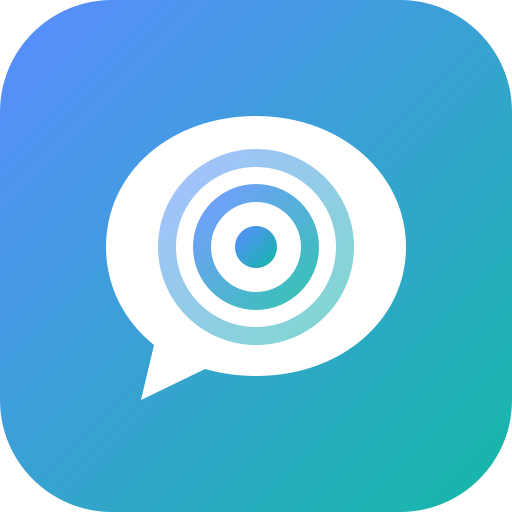
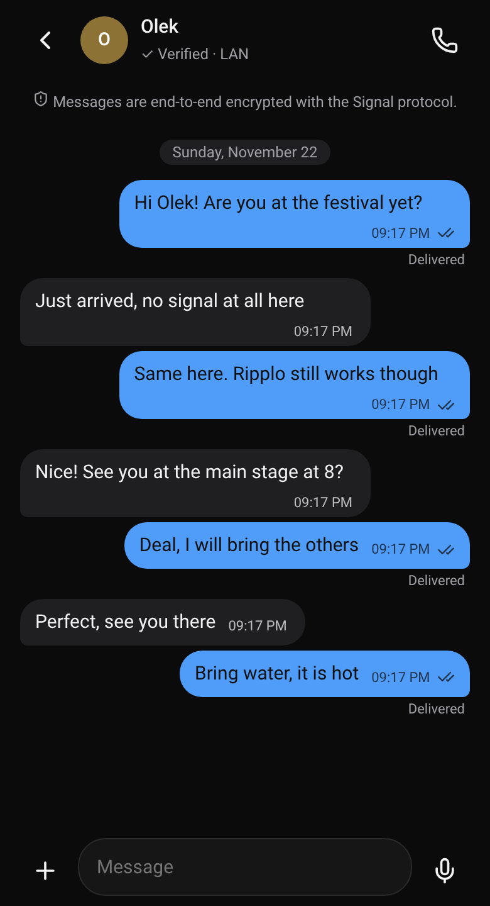
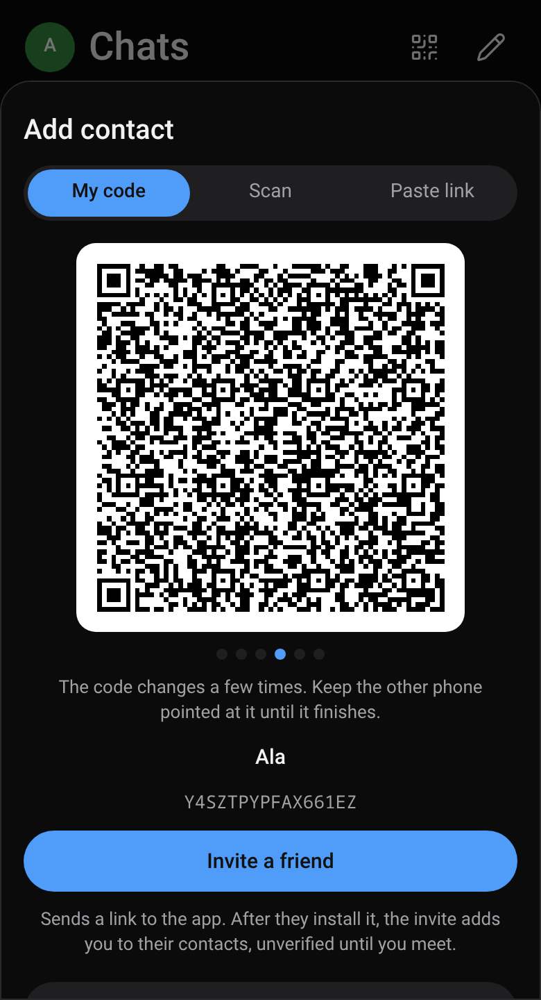
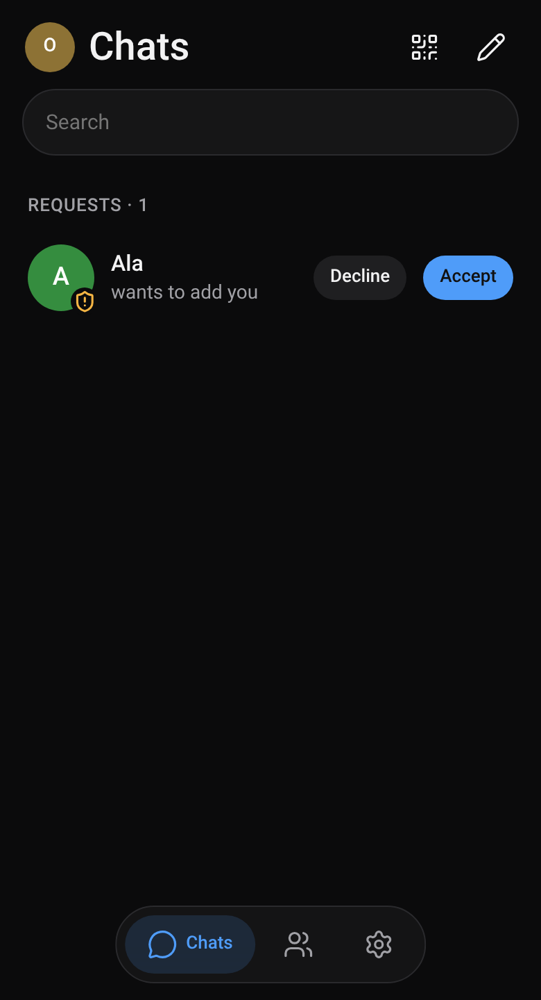

# Ripplo

🇬🇧 English | [🇵🇱 Polski](README.pl.md)

An offline, end-to-end encrypted mesh messenger. No servers, no accounts, no internet: messages hop from phone to phone over Bluetooth and Wi-Fi.

# Features

- **No servers, no accounts, no phone numbers, no internet connection needed.**
- Phones form a mesh: every phone in range can relay messages for others.
- End-to-end encryption with Signal's official `libsignal` library for chats, groups, voice notes, calls, photos and videos. Post-quantum protection: PQXDH (X25519 + Kyber-1024 / ML-KEM) key exchange.
- Those relaying a message cannot see who wrote it.
- Encrypted local database, with the key held in the Android Keystore / iOS Keychain.
- Several transports at once (BLE, Bluetooth, LAN, Wi-Fi Direct, Wi-Fi Aware, Apple Multipeer). The fastest working link is always used.
- Add friends with a QR code, an invite link (no server involved) or in the Find people tab.
- Key verification: compare QR codes in person or confirm manually.
- Relaying works with the screen off.
- Photos and videos (up to 20 MB).
- A variety of app themes.
- Checksum verification during updates.
- Polish and English languages.

# How to use?
1. [Install Ripplo](#install).
2. Enter a username. The keys are generated on the phone and never leave it.
3. Grant the permissions and, on Android, allow background relaying.
4. Add a friend: open the QR icon in the **Chats** tab and scan their code, paste an invite link, or pick them in the **Find people** tab.
5. [Verify the key](#verifying-a-contact) of the person you added, or wait for automatic verification (if you are nearby).
6. Write a message. If your friend is out of direct range, other Ripplo phones between you will relay it (if there are any nearby).

# How it works

## Transports

Every transport carries the same byte stream, so one person can be reachable over several links at the same time (for example Bluetooth Low Energy and Wi-Fi Direct). The app measures the speed of each link and always sends the encrypted messages through the fastest and most stable working link.

| Medium | Android | iOS | Android <-> iOS | 
|---|---|---|---|
| BLE (GATT) | yes | yes | yes |
| Bluetooth L2CAP (BLE CoC) | yes (Android 10+) | yes | yes |
|Bluetooth Long Range| yes | no | no |
| LAN | yes | yes | yes |
| Wi-Fi Direct | yes | no | no |
| Wi-Fi Aware | yes (Android 8+, needs hardware support) | no | no |
| Apple Multipeer | no | yes | no |

## Encryption

- **The Signal protocol**, via the `libsignal` library, with post-quantum protection.
- The sender's identity is wrapped in an extra layer that only the recipient can open, so the phones relaying a packet do not learn who is talking to whom.
- **Attachments** (voice notes, photos, videos) are encrypted once with a random key, then split into 32 KiB chunks and sent separately. The key is sent in a message encrypted with the **Signal** protocol.
- **Voice calls**: the call key is generated randomly at the start and passed to the other side in a message encrypted with the **Signal** protocol. The audio is encrypted with AES-256-GCM, and the key is deleted when the call ends.

> [!NOTE]
> Devices relaying packets cannot see who you are talking to or what you are sending to another person.

## Adding friends

- **QR code**: scan the code shown in **My code**.
- **Invite link**: `ripplo://add/...` contains your name and public keys.
- **"People nearby" tab**: asks the mesh who is nearby. The **People nearby** tab can return at most 20 people (a safeguard against overloading the network). 

## Verifying a contact (checking that the public key has not been swapped)

| Level | Meaning |
|---|---|
| Nearby | The key is verified over a direct link; the key's owner must be physically in range of the other person. |
| QR | Scanning the QR code in person. |
| Manual | Manually marking that the contact is who they claim to be. |

## How messages travel

- Every phone passes a packet on to its neighbors, and the route is remembered.
- There is no hop limit: a message crosses any chain of phones, however long.
- Messages cannot loop: every phone forwards a given packet at most once, and duplicates are dropped without being forwarded.
- If every path fails, the sender sees **"Out of range"**.
- Relaying happens in the background without any user action.

> [!NOTE]
> Relayed messages are never shown and never trigger a notification.

## App limits

- Text: 1000 characters.
- Attachments: 20 MB (before encryption), sent in chunks.
- Speed: 200 packets/s and 32 MiB queued per link; overflow is dropped.

## Updates and integrity

- When there is internet, the app checks the latest release on GitHub and shows an update window. On Android with auto-update on, the app downloads the APK, verifies the SHA-256 and the signing certificate, and then installs the app.
- On Android the app computes the `SHA-256` of its own installed APK and compares it with the release's `SHA256SUMS`. Copies shared via `Quick Share / Nearby Share` are verified too. The verification result is in `Settings` --> `Security`.

# Install

## Android

Download `Ripplo-vX.Y.Z.apk` from [Releases](https://github.com/Nahida4479/Ripplo/releases), or from the [official website](https://ripplo.nahida4479.org/).

## IOS

The release contains an **unsigned** IPA file (`Ripplo-vX.Y.Z-beta-unsigned-for_developers.ipa`). It has to be signed using [SideStore](https://sidestore.io/). Step-by-step SideStore guide: [nahida4479.github.io/Ripplo/pl/#ios](https://nahida4479.github.io/Ripplo/pl/#ios).

# Contributors

# License
Released under the [GNU Affero General Public License v3.0](./LICENSE) (AGPL-3.0-only) © 2026 [nahida4479](https://github.com/Nahida4479).
You may use, modify and share Ripplo, but anything you distribute or make available to others that is based on it must also be AGPL-3.0 with its source code available. Provided "as is", without warranty.
