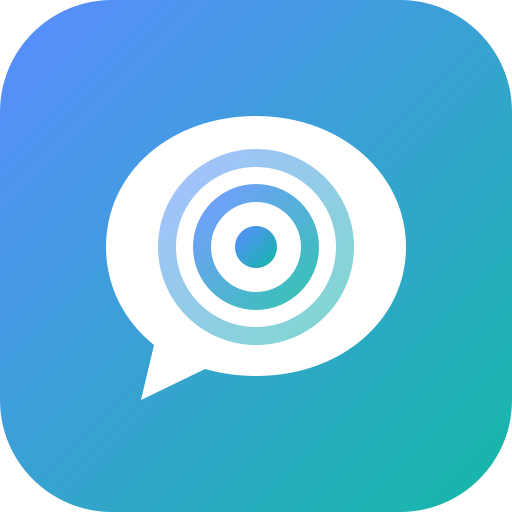

# Ripplo

[🇬🇧 English](README.md) | 🇵🇱 Polski

Komunikator mesh działający offline, z szyfrowaniem end-to-end. Bez serwerów, bez kont, bez internetu: wiadomości przeskakują z telefonu na telefon przez Bluetooth i Wi-Fi.

# Funkcje

- **Bez serwerów, kont i numerów telefonu, nie potrzeba połączenia z internetem.**
- Telefony tworzą sieć mesh: każdy telefon w zasięgu może przekazywać wiadomości innym.
- Szyfrowanie end-to-end oficjalną biblioteką Signal `libsignal` dla czatów, grup, wiadomości głosowych, rozmów, zdjęć i filmów. Ochrona postkwantowa: wymiana kluczy PQXDH (X25519 + Kyber-1024 / ML-KEM).
- Osoby przekazujące wiadomość nie widzą, kto napisał wiadomość.
- Zaszyfrowana lokalna baza danych, klucz przechowywany w Android Keystore / iOS Keychain.
- Kilka transportów naraz (BLE, Bluetooth, LAN, Wi-Fi Direct, Wi-Fi Aware, Apple Multipeer). Zawsze używane jest najszybsze działające łącze.
- Dodawanie znajomych kodem QR, linkiem zaproszenia (bez udziału serwera) lub w zakładce Znajdź osoby.
- Weryfikacja kluczy: porównanie kodów QR osobiście lub potwierdzając ręcznie.
- Przekazywanie działa przy wyłączonym ekranie.
- Zdjęcia i filmy (do 20 MB).
- Różnorodne motywy aplikacji.
- Sprawdzanie sum kontrolnych podczas aktualizacji.
- Język Polski i Angielski.

# Jak używać?
1. [Zainstaluj Ripplo](#instalacja).
2. Podaj nazwę użytkownika. Klucze są generowane na telefonie i nigdy go nie opuszczają.
3. Przyznaj uprawnienia, na Androidzie zezwól na przekazywanie w tle.
4. Dodaj znajomego: otwórz ikonę QR w zakładce **Czaty** i zeskanuj jego kod, wklej link zaproszenia albo wybierz go w zakładce **Znajdź osoby**.
5. [Zweryfikuj klucz](#weryfikacja-kontaktu) dodanej osoby lub poczekaj na automatyczną weryfikację (jeżeli jesteście w pobliżu).
6. Napisz wiadomość. Jeśli znajomy jest poza bezpośrednim zasięgiem, przekażą ją inne telefony z Ripplo znajdujące się pomiędzy wami (jeżeli takie są w pobliżu).

# Jak to działa

## Transporty

Każdy transport przenosi ten sam strumień bajtów, więc jedna osoba może być osiągalna jednocześnie przez kilka łączy (na przykład Bluetooth Low Energy i WiFi-Direct). Aplikacja mierzy prędkość każdego łącza i zawsze zaszyfrowane wiadomości przez najszybsze i najbardziej stabilnia działające łącze.

| Medium | Android | iOS | Android <-> iOS | 
|---|---|---|---|
| BLE (GATT) | tak | tak | tak |
| Bluetooth L2CAP (BLE CoC) | tak (Android 10+) | tak | tak |
| LAN | tak | tak | tak |
| Wi-Fi Direct | tak | nie | nie |
| Wi-Fi Aware | tak (Android 8+, wymaga wsparcia sprzętowego) | nie | nie |
| Apple Multipeer | nie | tak | nie |

## Szyfrowanie

- **Protokołem Signal**, biblioteka `libsignal`, z ochroną postkwantową.
- Tożsamość nadawcy jest zapakowana w dodatkową warstwę, którą może otworzyć tylko odbiorca, więc telefony przekazujące pakiet nie dowiadują się, kto z kim rozmawia.
- **Załączniki** (wiadomości głosowe, zdjęcia, filmy) są szyfrowane raz losowym kluczem a następnie są dzielone na fragmenty po 32 KiB i wysyłane osobno. Klucz przesyłany jest w wiadomości zaszyfrowanej protokołem **Signal**.
- **Połącznia głosowe**, klucz rozmowy jest losowany na początku i przekazywany drugiej stronie z użyciem zaszyfrowanej wiadomości **protokołem Signal**. Dźwięk jest szyfrowany algorytmem AES-256-GCM, a po zakończeniu rozmowy klucz jest usuwany.

> [!NOTE]
> Urządzenia przekazujące pakiety nie mogę zobaczyć z kim się kontaktujesz oraz co wysyłasz innej osobie.

## Dodawanie znajomych

- **Kod QR**: zeskanuj kod widoczny w **Mój kod**.
- **Link zaproszenia**: `ripplo://add/...` zawiera twoje imię i klucze publiczne.
- **Zakładka "Osoby w pobliżu"**: pyta sieć mesh, kto jest w pobliżu. Zakładka **Osoby w pobliżu** może zwrócić maksymalnie 20 osób (zabezpieczenie przed przeciążeniem sieci). 

## Weryfikacja kontaktu (spradzenie czy klucz publiczny nie został podmieniony)

| Poziom | Znaczenie |
|---|---|
| W pobliżu (Nearby) | Zweryfikowanie klucza przez bezpośrednie łącze, właściciel klucza musi być fizycznie w zasięgu drugiej osoby. |
| QR | Zeskanowanie osobiście kodu QR. |
| Ręcznie | Ręczne zaznaczenia że dany kontakt jest tym za kogo się podaje. |

## Jak podróżują wiadomości

- Każdy telefon przekazuje pakiet swoim sąsiadom, a trasa zostaje zapamiętana.
- Brak limitu przeskoku, wiadomość przejdzie przez dowolnie długi łańcuch telefonów.
- Wiadomości nie mogą krążyć w pętli, każdy telefon przekazuje dany pakiet najwyżej raz, a duplikaty są odrzucane bez przekazywania dalej.
- Jeśli wszystkie ścieżki zawiodą, nadawca widzi informację **„Poza zasięgiem”**.
- Przekazywanie odbywa się w tle bez ingerencji użytkownika.

> [!NOTE]
> Wiadomości przekazywane dalej nigdy nie są wyświetlane i nigdy nie wywołują powiadomienia.

## Limity aplikacji

- Tekst: 1000 znaków.
- Załączniki: 20 MB (przed szyfrowaniem), wysyłane we fragmentach.
- Prędkość: 200 pakietów/s i 32 MiB w kolejce na łącze; nadmiar jest odrzucany.

## Aktualizacje i integralność

- Gdy jest internet, aplikacja sprawdza najnowsze wydanie na GitHubie i pokazuje okno aktualizacji. Na Androidzie z włączoną automatyczną aktualizacją aplikacja pobiera APK, weryfikuje SHA-256 i certyfikat podpisu, a następnie instaluje aplikację.
- Na Androidzie aplikacja liczy `SHA-256` własnego zainstalowanego APK i porównuje go z `SHA256SUMS` wydania. Weryfikowane są także kopie udostępnione przez `Quick Share / Nearby Share`. Wynik weryfikacji znajduje się w `Ustawienia` --> `Bezpieczeństwo`.

# Instalacja

## Android

Pobierz `Ripplo-vX.Y.Z.apk` z [Releases](https://github.com/Nahida4479/Ripplo/releases). Bądź ze strony z [oficjalnej strony](https://ripplo.nahida4479.org/) 

## IOS

Wydanie zawiera **niepodpisany** plik IPA (`Ripplo-vX.Y.Z-unsigned.ipa`). Trzeba go podpisać z użyciem [SideStore](https://sidestore.io/). Instrukcja krok po kroku dla SideStore: [nahida4479.github.io/Ripplo/pl/#ios](https://nahida4479.github.io/Ripplo/pl/#ios).

# Współtwórcy

- [Nahida4479](https://github.com/Nahida4479)

# Licencja
Udostępniono na licencji [GNU Affero General Public License v3.0](./LICENSE) (AGPL-3.0-only) © 2026 [nahida4479](https://github.com/Nahida4479).
Możesz używać, modyfikować i udostępniać Ripplo, ale wszystko, co rozpowszechniasz lub udostępniasz innym na jego podstawie, również musi być na AGPL-3.0 z udostępnionym kodem źródłowym. Dostarczane „tak jak jest”, bez gwarancji.
